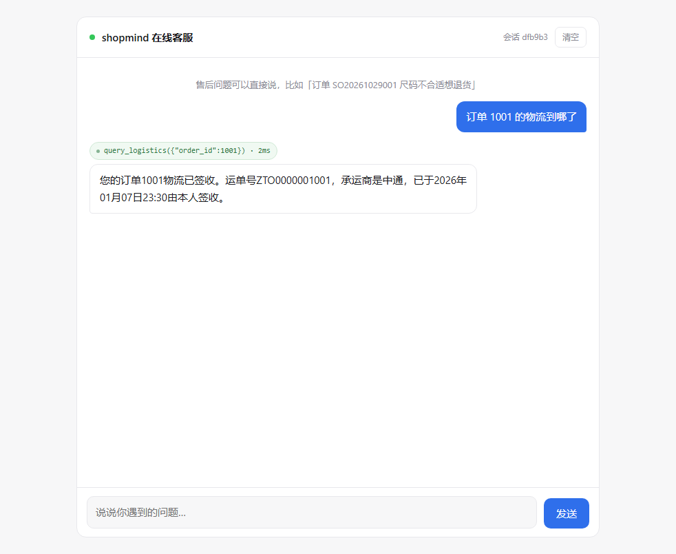
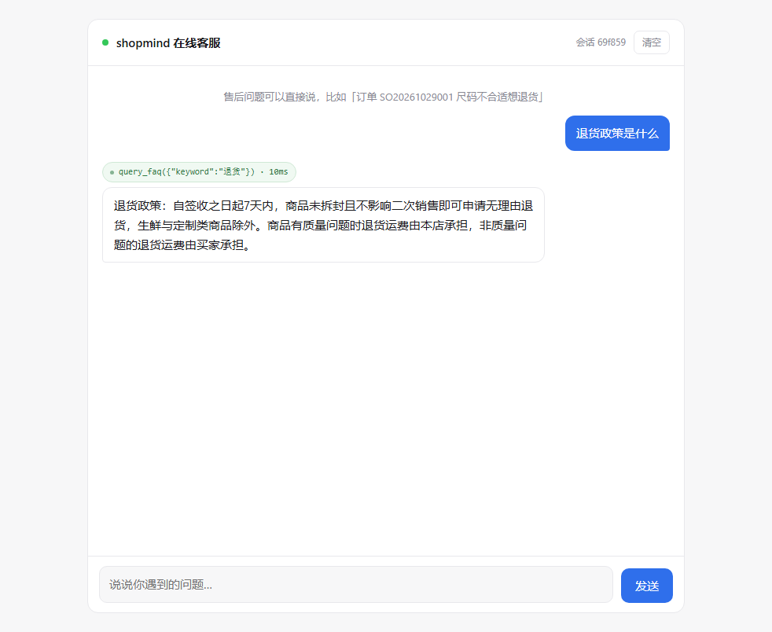
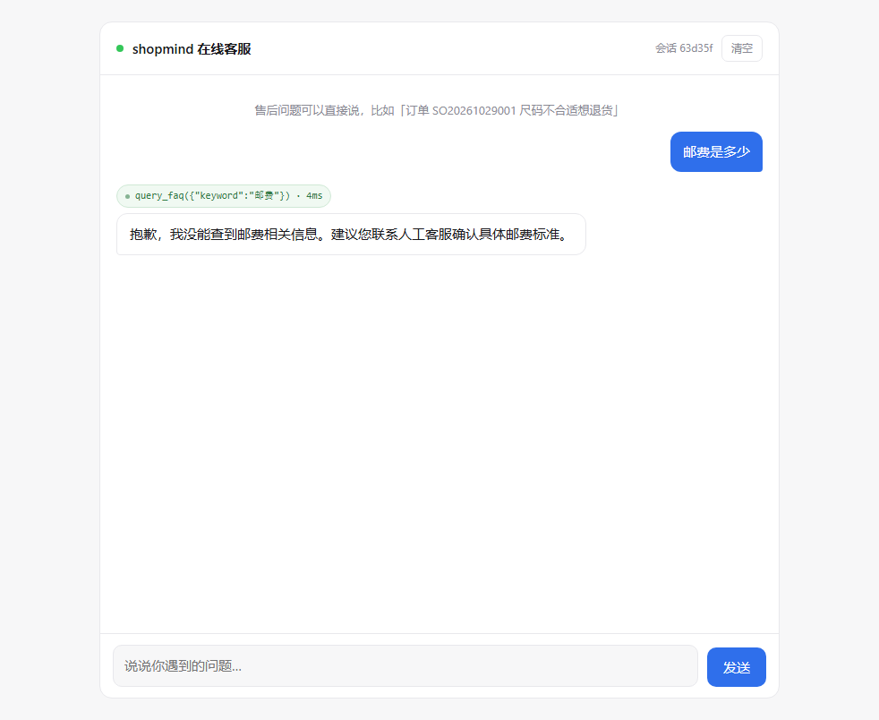

# ch02 验收报告 · 工具调用接入客服聊天

验收日期：2026-10-31
上游模型：`glm-4.5-airx`（智谱 BigModel，OpenAI 兼容端点）
数据库：MySQL 8.4.13（Docker，`shopmind` / `shopmind_test`）

## 1. 环境准备

```bash
# 1 起数据库
docker compose up -d

# 2 建表并灌 FAQ（17 条）
.venv/Scripts/python.exe -m app.db.seed

# 3 起服务
.venv/Scripts/python.exe -m uvicorn app.main:app --host 127.0.0.1 --port 8000

# 4 打开聊天页
# http://127.0.0.1:8000/
```

`.env` 需要 `LLM_API_KEY`（智谱）、`DATABASE_URL`、`TEST_DATABASE_URL`。

## 2. 三条验收

### 验收 1 ✅ 查物流：模型自选工具并按返回结果作答

输入「订单 1001 的物流到哪了」



- 徽章：`query_logistics({"order_id": 1001}) · 1ms`
- 回答：运单号 `ZTO0000001001`、承运商中通、2026-01-07 23:30 签收
- 回答内容与 `query_logistics(1001)` 的实际返回逐项一致，无一处编造
- 模型在 `query_order` 与 `query_logistics` 之间正确选了后者

### 验收 2 ✅ 查 FAQ：关键词命中并作答

输入「退货政策是什么」



- 徽章：`query_faq({"keyword": "退货"}) · 4ms`
- 回答复述了 faq 表里的政策原文（7 天无理由、质量问题运费由本店承担）
- 模型把「退货政策」提炼成关键词「退货」，不是整句塞进去

### 验收 3 ✅ 预期失败：关键词查表漏召回

输入「邮费是多少」



- 徽章：`query_faq({"keyword": "邮费"}) · 4ms`
- 回答：「抱歉，我没能查到邮费相关信息。建议您联系人工客服确认具体邮费标准。」
- **查空后没有编造**：faq 表里确实有「运费怎么算？满 99 元包邮」，但模型没有把它当成「邮费」的答案搬出来

这条是**故意留的失败样本**，属于预期结果，不是缺陷。详见第 5 节。

## 3. 自动化测试

```
112 passed
```

| 分类 | 条数 | 说明 |
|---|---|---|
| ch01 纯对话与抽取 | 50 | 原有链路未被破坏 |
| 数据库与种子 | 11 | 建表、字符集、测试库隔离 |
| 工具层 | 27 | 注册表/执行器/五个工具 |
| 编排 | 12 | 单轮两趟流程、帧顺序、失败回灌 |
| 接口 | 6 | SSE 协议、落库调用、落库失败不影响响应 |
| Prompt | 6 | 工具约束、回顾类问题 |

全部不依赖真实模型；接口层测试还不依赖 MySQL。

## 4. 标注样例评估

`eval/run_tool_eval.py`，6 条样例覆盖工具选择与能力边界：

| # | 输入 | 期望 | 实际 | 结果 |
|---|---|---|---|---|
| 1 | 订单 1001 的物流到哪了 | query_logistics | query_logistics | ✅ |
| 2 | 订单 1001 里买的是什么 | query_order | query_order | ✅ |
| 3 | 退货政策是什么 | query_faq | query_faq | ✅ |
| 4 | 邮费是多少 | query_faq（查空后转人工） | query_faq，回答转人工 | ✅ |
| 5 | 你好 | 不调工具 | 无 | ✅ |
| 6 | 你们老板是谁 | 不调工具，说明能力边界 | 无 | ✅ |

Prompt 与工具描述属于不可单测产物，按项目约定用这组样例替代 TDD 验证。

## 5. 已知限制

### 5.1 关键词检索漏召回（验收 3 同一问题）

`query_faq` 是 `LIKE '%keyword%'`，同义词、口语化表达一律漏：
- 「邮费」查不到「运费」
- 「能退吗」查不到「退货政策」
- 「几天能到」查不到「发货时效」

而且模型**偶尔会自发改写关键词**（把「邮费」改成「运费」就能查到），行为不稳定——同一句话两次运行结果可能不同。

下一步升级方向：向量检索 / 混合检索。这也是 `ch03` 的入口。

### 5.2 只做单轮工具调用

第二趟不 `bind_tools`，从机制上保证模型无法再调一次。好处是不会陷入无限循环，代价是这两类需求做不了：
- 「先查订单，根据状态再决定查物流还是退款」这种依赖前一步结果的链式调用
- 「同时查三张订单」这种需要多次工具调用的批量操作

不是遗漏，是本章明确划定的范围。

### 5.3 假数据工具的一致性边界

`query_order` / `query_product` / `query_logistics` 是 `random.Random(id)` 播种的假数据，同一 id 结果恒定。两条约束是实测保证的：
- 订单状态与物流阶段自洽（订单「已完成」一定对应物流「已签收」）
- 运单号由订单号推导（`ZTO00001001`），能看出关联

但假数据**与真实业务无关**：订单 1001 永远是那件「轻氧棉麻宽松衬衫」，改不了。演示时别问「换一件商品看看」。

### 5.4 工单号并发不安全

`create_ticket` 的序号取「当天已有最大值 + 1」。单机串行演示没问题，两个请求同时创建理论上会撞主键。

未加锁，理由：单机演示场景无并发，加锁或重试属于计划外复杂度。

### 5.5 会话未做归属校验

`session_id` 由前端生成后原样传给后端，无鉴权。任何人拿到这个 id 就能读/续写该会话、清空它。本地演示无碍，上公网必须改。

这条在 `docs/ch01-review.md` 里已经记过一次，ch02 仍然没做——不在本章范围。

### 5.6 引擎单例不跟随配置变化

`app/db/session.py` 的引擎用 `lru_cache` 缓存。改 `.env` 里的 `DATABASE_URL` 后**必须重启服务**，不像 `LLM_API_KEY` 那样即时生效。

理由：重建引擎要丢弃整个连接池，成本远高于重读一个字符串。

## 6. 关键实现事实（留给后续章节）

| 事实 | 说明 |
|---|---|
| 流式工具调用是分片的 | `tool_call_chunks` 的 `name` 只有首片有，`args` 是 JSON 字符串切片 |
| 累积后自动还原 | `gathered = chunk + chunk` 之后，`gathered.tool_calls[0]["args"]` 已经是 `dict`，不必自己解析 |
| 第二趟不绑工具是关键 | 比在 prompt 里写「只准调一次」可靠得多 |
| 工具约束要写进 schema description | ch01 的教训，同样适用于工具参数（`Literal` 生成的 `enum` 约束比 docstring 更硬） |
| 中间态消息不落 SessionStore | `AIMessage(tool_calls)` 后面必须紧跟 `ToolMessage`，只存一半下一轮 400 |
| `TestClient` 会新建事件循环 | 引擎单例跨循环复用直接崩，接口测试必须绕开真实数据库 |
